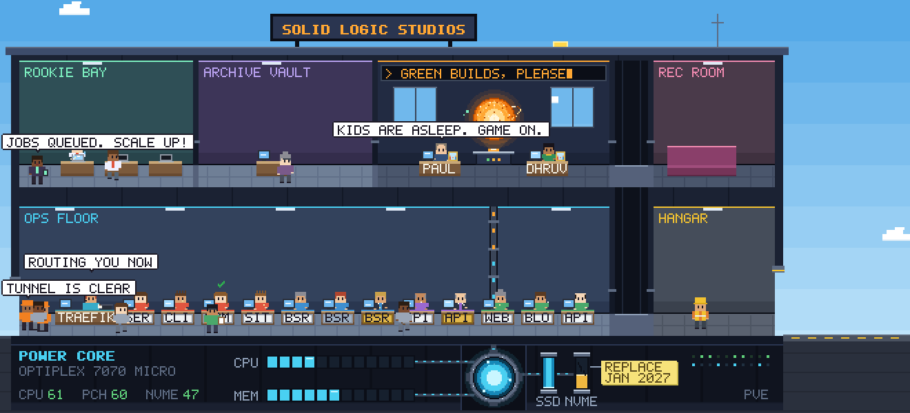
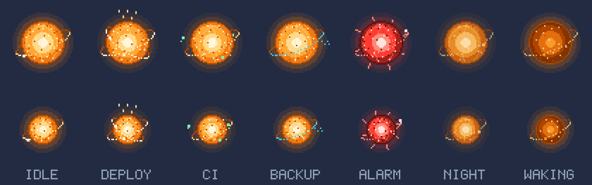
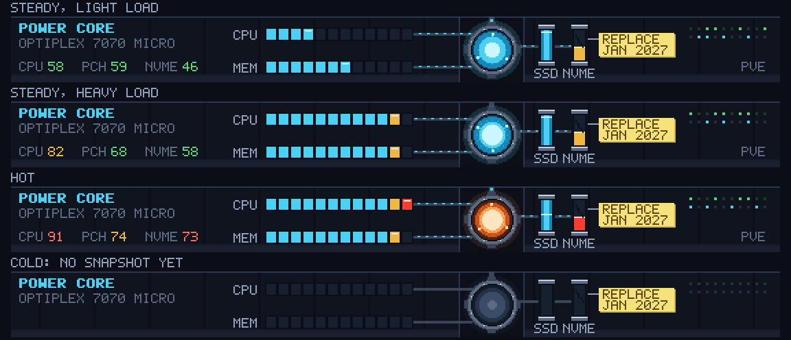
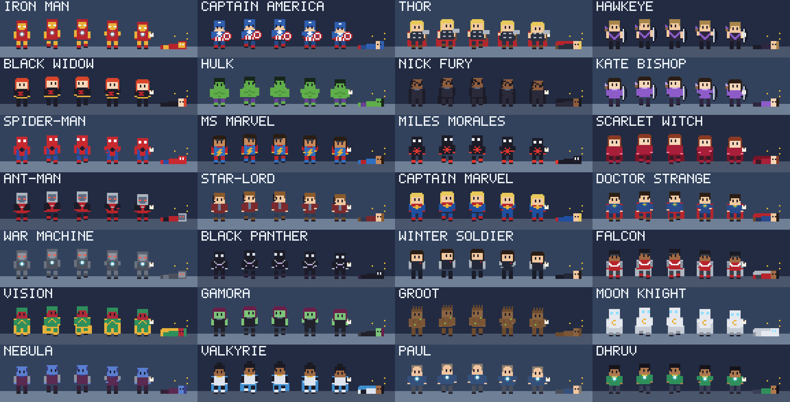

# HQ theme: design spec

The design for issue #4: the lab as a superhero HQ with JARVIS at the helm. This is the spec the
builders follow. It covers the art direction, both layouts, the mapping from the lab to the HQ, the
cast, the words, the sound and the build slices.

- **Status:** signature art built and on stage; the rest is specified here and not yet built.
- **Original work only.** A genre homage: no Marvel (or other publisher's) characters, names, logos,
  likenesses or downloaded assets. The name JARVIS stays because the issue and the `/ticket` loop use it.
  **Reversed for the cast by issue #75 (section 14):** the Avengers play the Parts, by name. The art
  stays original pixel art, with no logos and no downloaded or traced assets.
- **No Engine change.** Everything here is a Theme: data and pure drawing functions through the
  `Painter` (ADR 0003). **Section 14 is the exception:** costumes are drawn by the Engine's sprite
  renderer, so they are a contract change with an ADR 0003 amendment.

## 1. What exists now

| Piece                                                         | Where                                               |
| ------------------------------------------------------------- | --------------------------------------------------- |
| Palette                                                       | `src/themes/hq/palette.ts`                          |
| Discs, waves and orbits (the kit)                             | `src/themes/hq/kit.ts`                              |
| What JARVIS is attending to                                   | `src/themes/hq/jarvis-state.ts`                     |
| JARVIS line bank and the typed readout's timing               | `src/themes/hq/jarvis-lines.ts`, `jarvis-speech.ts` |
| The orb                                                       | `src/themes/hq/orb.ts`                              |
| The console (readout, projector, orb)                         | `src/themes/hq/jarvis-console.ts`                   |
| The power core                                                | `src/themes/hq/core.ts`                             |
| Stage size, decks, rooms                                      | `src/themes/hq/geometry.ts`                         |
| Set-piece positions                                           | `src/themes/hq/boards.ts`                           |
| Bare structure, spine, night tint, all-hands wash             | `src/themes/hq/shell.ts`                            |
| Layout (final positions, stand-in furniture)                  | `src/themes/hq/layout.ts`                           |
| Orb and core hover text                                       | `src/themes/hq/hotspots.ts`                         |
| `hqTheme`, registered third in `THEMES`                       | `src/themes/hq/index.ts`, `src/themes/index.ts`     |
| Tests                                                         | `tests/themes/hq.test.ts`                           |
| Reference renders (exact pixels) and live browser screenshots | `docs/design/hq/`                                   |

**Stand-ins to replace.** `hqTheme` borrows the Office's cast, founders, visitor, lines, legend and
Soundscape, and `layout.ts` uses the Office's furniture art and break-spot kinds. Each is marked in
the code and replaced by a slice in section 11. Office stays the default Theme; `src/main.ts` is
untouched.

See it: `pnpm dev`, then `?sim&theme=hq`.



## 2. Art direction

**The idea.** A working HQ seen in cutaway: graphite and steel, lit by two glows. **Amber is JARVIS**
and **cyan is the power core**. The core sits in the sub-level straight under the orb and a conduit
(the spine) joins them up the back wall of the ops floor, so the picture reads top to bottom as
"the core powers the mind". **Red is kept for the alarm**: nothing else on stage is that red, so red
always means trouble.

**Rules.**

- Walls are mid-dark and desaturated so bright suits and the two glows read against them. Each room
  has one accent colour: a 1 px strip under the ceiling and its label.
- Round things are stacks of rows (`disc` in `kit.ts`). Glows are one or two low-alpha discs behind
  the object, never a gradient.
- Everything that moves is a function of `stage.now`. **Speeds never depend on live readings**, or
  the animation would jump at every Snapshot. A reading changes size, count, colour or brightness.
- **Nothing large strobes.** A whole-room or whole-stage light swells with `wave()` at 1.5 Hz or
  slower. Hard flicker is for things a few pixels across (a spark, a cursor, a lamp).
- On-screen text is capitals in the pixel font (6 px a character, 7 bold), Australian English, no
  em-dashes. Size every board from its text and put its rectangle in `boards.ts`.
- Keep the Office's personality where it is about Paul and Dhruv (the LAN nights, the couch), not
  about offices.

**Palette** (`palette.ts`; add to it, do not inline new colours in art files).

| Family | Tokens                                                    | Use                                             |
| ------ | --------------------------------------------------------- | ----------------------------------------------- |
| Ink    | `INK` `#0b0e17`, `PAPER` `#eef3f8`                        | Outlines and board faces; light text            |
| Hull   | `HULL.dark/base/light/trim`                               | Outer plating, slabs, plinths                   |
| Steel  | `STEEL.dark/base/light/shine`                             | Fittings, frames, pipes, labels                 |
| Amber  | `AMBER.ember/rim/base/glow/hot/white`                     | JARVIS: orb, readout, projector, founders' gold |
| Cyan   | `CYAN.deep/base/bright/hot`                               | Core, conduits, live screens                    |
| Alarm  | `ALARM.deep/dark/base/light/white`                        | Critical and down, only                         |
| Lamps  | `LAMP.ok` green, `LAMP.warn` amber, `UNLIT`               | Signal lamps, unlit cells and dead screens      |
| Rooms  | `ROOMS.rookieBay/archive/command/rec/ops/hangar/sublevel` | Wall, shade, floor, seam and accent per room    |

Client colours and the temperature bands are the Office's (`CLIENT_COLOURS`, `TEMP_COLOURS`), so a
client is the same colour in every Theme.

## 3. Decisions for JARVIS

Each has a recommendation. The slices assume the recommendation.

| #   | Decision                                                                                                                                                                                                                                                                                                                                    | Recommendation                                                                                             |
| --- | ------------------------------------------------------------------------------------------------------------------------------------------------------------------------------------------------------------------------------------------------------------------------------------------------------------------------------------------- | ---------------------------------------------------------------------------------------------------------- |
| D1  | **Team name.** The team needs an original name for blurbs, the legend and JARVIS's lines.                                                                                                                                                                                                                                                   | **The Nines** (as in five nines of uptime). The roof sign stays `SOLID LOGIC STUDIOS`.                     |
| D2  | **JARVIS as a Founder.** The readout is silent decor. To give JARVIS a voice, bubbles and check-ins with no Engine change, cast it as a third `Founder` with a `BoxLook`: a small amber remote that docks beside the console and does the rounds. As `founders[0]` it also becomes the announcer's Voice and takes its turn at the Standup. | **Yes**, as `founders[0]`. It is the cheapest way to put JARVIS "at the helm" in sound as well as picture. |
| D3  | **Phone Theme's id and name.**                                                                                                                                                                                                                                                                                                              | id `spire`, name `HQ Spire`, listed after `hq`.                                                            |
| D4  | **Shared theme kit.** HQ is the third Theme to need the Office's `pen`, `hash`, `temps` and `sky`. ADR 0003's amendment says to move them to a shared module at that point.                                                                                                                                                                 | Do it first (slice 1), with an ADR amendment.                                                              |
| D5  | **What "a deploy" means to the orb.** `StageView` has no deploy flag. The orb reads the deploy runner's CPU (the `runner` workload where the Snapshot lists it, else the deploy VM) at or above `DEPLOY_BUSY_CPU` (30).                                                                                                                     | Keep it. It is honest (the runner is working) and needs no contract change.                                |

Proposed names are original as far as I know. JARVIS should give the roster in section 7 one last
check against well-known characters before it ships.

## 4. Desktop layout (the main focus)

A 660 by 300 stage: the Office's two decks (so a person is the same size against the furniture) over
a 48 px sub-level, with a gate at the left and a jet apron at the right. All numbers are art pixels.

```
y   0 ┌───────────────────────── sky ───────────────── roof sign, mast ──────────────┐
   40 ├ROOKIE BAY──┬ARCHIVE VAULT┬──COMMAND DECK─────┬lift┬─REC ROOM──┐              │
      │ ci         │ data        │ readout           │    │ couch     │   bunker on  │
      │ tube 3 benches│ 2 lockers │ window (ORB) window│   │ telly, bag│   the horizon│
  136 ├────────────┴─────────────┴───────────────────┤    ├───────────┤              │
  150 │OPS FLOOR  (compute)           spine│         │    │ HANGAR    │              │
      │ gate, dispatch, 12 watch stations  │  holo   │    │ (deploy)  │ door  apron, │
  244 ├────────────────────────────────────┴─────────┴────┴───────────┴────── jet ───┤
  250 │ POWER CORE  nameplate, temps │ CPU/MEM banks │ (HUB) │ SSD NVME note │ relays│
  298 └───────────────────────────────────────────────────────────────────────────────┘
x     8  14        140 144       270 274    358     442 446 470 474     562 568      660
```

**Decks** (`geometry.ts`).

| Deck      | Index | Ceiling | Wall ends | Floor front | Walk line | Walk span  |
| --------- | ----- | ------- | --------- | ----------- | --------- | ---------- |
| Ground    | 0     | 150     | 228       | 244         | 242       | -12 to 610 |
| Upper     | 1     | 44      | 120       | 136         | 134       | 14 to 562  |
| Sub-level | none  | 250     |           | 298         |           | not walked |

Lift at x 458 (shaft 446 to 470). Doorways (32 px tall) wherever a wall crosses a walk line: x 140
and 270 on the upper deck, 442 and 470 on both. The gate is the opening in the left wall (x 8 to 14,
y 204 to 244); the hangar door is the opening in the right wall (x 562 to 568, y 198 to 244).

**Rooms.**

| Room          | Span (x)   | Deck   | VM role   | Accent |
| ------------- | ---------- | ------ | --------- | ------ |
| Rookie bay    | 14 to 140  | upper  | `ci`      | mint   |
| Archive vault | 144 to 270 | upper  | `data`    | violet |
| Command deck  | 274 to 442 | upper  | none      | amber  |
| Rec room      | 474 to 562 | upper  | none      | pink   |
| Ops floor     | 14 to 442  | ground | `compute` | cyan   |
| Hangar        | 474 to 562 | ground | `deploy`  | yellow |
| Power core    | 8 to 568   | sub    | the host  | cyan   |

**Homes** (`layout.ts`; a station is 21 tall with its base 6 px behind the walk line and its sitter
9 px behind).

| Part       | Who (section 7)    | Home                                                                  |
| ---------- | ------------------ | --------------------------------------------------------------------- |
| `worker`   | heroes on watch    | 12 watch stations on the ops floor: x = 88 + 29i, 24 wide, seat +14   |
| `greeter`  | Switchboard        | Dispatch desk, ops floor, x 40, 46 wide, seat +26                     |
| `guard`    | Ping and Pong      | Posts at x 20 and 31, inside the gate                                 |
| `checker`  | Vitals             | Post at x 74, ops floor                                               |
| `keeper`   | Ledger             | Archive desk, x 186, 24 wide, seat +14, between the two lockers       |
| `courier`  | Payload            | Post at x 508, hangar                                                 |
| `wrangler` | Muster             | Post at x 27, rookie bay                                              |
| `pod`      | rookies            | Benches at x 44, 76, 108, rookie bay                                  |
| `founder`  | Paul, Dhruv        | Consoles at x 304 and 382 (30 wide, seat +16), either side of the orb |
| `founder`  | JARVIS remote (D2) | Dock: a post at x 420, right of Dhruv's console                       |

**Spots.**

| What        | Where                 | Notes                                                                 |
| ----------- | --------------------- | --------------------------------------------------------------------- |
| Entrance    | x -12, ground         | The gate                                                              |
| Pod spawn   | x 20, upper           | The suit-up tube in the rookie bay's left wall                        |
| Stores      | x 165 and 233, upper  | In front of the PostgreSQL and MySQL lockers (x 150 and 218, 30 wide) |
| Vault       | x 604, ground         | The jet's ramp on the apron, outside the hangar door                  |
| Break spots | in index order, below | The stage reports busy spots by index                                 |

| Index   | x             | Deck   | Kind                 | Dressing it needs                                     |
| ------- | ------------- | ------ | -------------------- | ----------------------------------------------------- |
| 0, 1    | 283, 295      | upper  | `brew`               | Brew station, command deck, x 278 to 300              |
| 2, 3, 4 | 496, 509, 522 | upper  | `couch` (`sitY` 125) | The rec room couch (built: back and front prop)       |
| 5       | 548           | upper  | `bag`                | Punching bag, rec room; swings while the spot is busy |
| 6       | 422           | ground | `holo`               | Holo-table on the ops floor's back wall               |
| 7       | 436           | upper  | `trophy`             | Trophy shelf, command deck, far right                 |

**Set pieces** (`boards.ts`).

| Piece            | Position                                                         |
| ---------------- | ---------------------------------------------------------------- |
| JARVIS readout   | x 276, y 47, 164 by 12                                           |
| Orb              | centre 358, 86; radius 15 (paints out to 24 from its centre)     |
| Projector        | x 343, y 108, 30 by 12                                           |
| Command windows  | 286, 64 and 400, 64; each 30 by 28                               |
| Spine            | x 356, 4 wide, the full height of the ops floor's back wall      |
| Core hub         | centre 358, 274; radius 17                                       |
| Cell banks       | from x 170: CPU row at y 259, memory row at y 283, 12 cells each |
| Drive cells      | SSD at x 392, NVMe at x 416, top y 256, each 12 by 30            |
| Replacement note | x 436, y 262, 56 by 18                                           |
| Nameplate        | x 14: title, model and temperatures on baselines 262, 273, 290   |
| Relays           | x 502, y 258, 10 columns; the host's name under them             |

## 5. Phone layout: the HQ Spire

A second Theme in the Tower's pattern (`src/themes/tower/index.ts`): `spireTheme` reuses the HQ's
cast, founders, visitor, lines, legend and Soundscape, and brings its own layout, places, shell and
Hotspots. It is 212 wide with seven 52 px storeys under a 40 px roof, like the Tower, so the Tower's
slot and band helpers carry over (extract them when the Spire becomes their second user).

**The silhouette is the point:** the orb sits in the open on the roof, so on a phone the HQ is a
spire with a glowing beacon on top and a glowing core at its foot.

| Floor | Storey                   | Holds                                                                                             |
| ----- | ------------------------ | ------------------------------------------------------------------------------------------------- |
| roof  | y 0 to 40                | The orb on its projector, the findings lamp on the lift's motor room. No big sign.                |
| 6     | Command deck             | The readout across the back wall, the founders' two consoles, the remote's dock, the brew station |
| 5     | Rookie bay               | Muster's post, three benches, the suit-up tube by the lift                                        |
| 4     | Archive vault and hangar | Split at x 126: Ledger's desk and two lockers; Payload's post and the gear rack                   |
| 3, 2  | Ops floor                | Six watch stations each                                                                           |
| 1     | Gate                     | Ping and Pong, the dispatch desk, Vitals; the entrance is off stage to the left                   |
| 0     | Sub-level                | The power core (x 6 to 146) and the jet silo (x 150 to 182), which is the vault                   |

The signature art is placed by spec, so the Spire passes its own numbers to the same functions.

```ts
// Starting numbers. Tune by eye with the render script (section 12).
const JARVIS: ConsoleSpec = {
  orb: { cx: 96, cy: 19, r: 10 }, // reach is r + 9, so it just fits the 40 px roof band
  pedestal: { x: 84, y: 32, w: 24, h: 8 },
  readout: { x: 8, y: 46, w: 164, h: 12 }, // 164 is READOUT_MIN_WIDTH
};
const CORE: CoreSpec = {
  chamber: { x: 6, y: 355, w: 140, h: 35 },
  hub: { cx: 99, cy: 372, r: 11 },
  banks: { x: 8, cpuY: 359, memY: 377, cells: 6 },
  drives: { ssdX: 117, nvmeX: 132, y: 355 },
  // No tag, plate or relays: there is no room.
};
```

The Spire's chamber is 35 px tall and a drive cell with its label is 39, so the Spire's builder owns
one small change to `core.ts`: make the drive labels optional, and show the three temperatures as a
strip on the storey's floor band (as the Tower's plant room does).

Carry over from the Tower: every Place's hover box is at least 30 by 30 (a 44 CSS px touch target),
`+N` overflow signs when the lab has more site instances or pods than homes, the lift car and
landing lamps from `StageView.lift`.

## 6. The lab, mapped to the HQ

### VM roles and the host

| Lab              | HQ                  | Rendering                                                                                                          |
| ---------------- | ------------------- | ------------------------------------------------------------------------------------------------------------------ |
| Compute host     | Ops floor           | One hero per Site instance at a watch station; the tactical wall, heartbeat monitor and clock behind them          |
| Data VM          | Archive vault       | Ledger at the archive desk between two lockers (PostgreSQL, MySQL); a locker stands open while `openStores` has it |
| Deploy runner    | Hangar              | Payload by the gear racks; the hangar lights run while Payload is away from the post (`occupant.atSeat` is false)  |
| CI runner VM     | Rookie bay          | Muster with a tablet, three benches, the suit-up tube, a mission board                                             |
| Lab host         | Power core          | The reactor in the sub-level (built). CPU and memory light the banks; temperatures on the nameplate                |
| Worn NVMe        | The sputtering cell | Under half charge, flickering, cracked, sparking, with the `REPLACE JAN 2027` note (built)                         |
| R2 bucket        | The off-site bunker | A bunker on the horizon at the far right; its beacon lights while the jet is there                                 |
| The orchestrator | JARVIS              | The orb and readout on the command deck (built), and the remote (D2)                                               |
| A down VM        |                     | The Engine dims the room and prints `OFFLINE`; the HQ adds the all-hands alarm (below)                             |

### Parts

| Part       | Lab thing                | HQ character                            | Behaviour the Engine already gives it   |
| ---------- | ------------------------ | --------------------------------------- | --------------------------------------- |
| `worker`   | Site instance            | A hero of the Nines on watch            | Works a station, takes breaks           |
| `pod`      | CI pod                   | A rookie on a single mission            | Runs in, works flat out, vanishes       |
| `greeter`  | Traefik                  | Switchboard, dispatch                   | Greets citizens at the front            |
| `guard`    | cloudflared, two of them | Ping and Pong, the Tunnel Twins         | Stand at the gate                       |
| `checker`  | Gatus                    | Vitals, the field medic                 | Walks the rounds; runs the health check |
| `keeper`   | Data VM                  | Ledger, the archivist                   | Answers queries; flies the backup       |
| `courier`  | Deploy runner            | Payload, the quartermaster              | Wheels the new gear in                  |
| `wrangler` | CI autoscaler            | Muster, the drill instructor            | Minds the rookies                       |
| `founder`  | not in the Snapshot      | Paul, Dhruv, and the JARVIS remote (D2) | Console, breaks, check-ins, the Standup |
| visitor    | an HTTP request          | A citizen                               | Walks in to a hero and out again        |

### Moods

The Engine draws the pose. The Theme's part is the watch station's art (`PlaceArt` reads `occupant`).

| Mood       | When              | Hero (Engine)                   | Watch station (Theme)                                                                              |
| ---------- | ----------------- | ------------------------------- | -------------------------------------------------------------------------------------------------- |
| `working`  | normal            | Types                           | Screen on in cyan with a line scrolling; client-colour strip on the console                        |
| `break`    | CPU under 10%     | Walks to a break spot           | Screen on standby: a slow amber dot                                                                |
| `stressed` | CPU over 80%      | Types frantically               | Screen amber with a blinking warning mark                                                          |
| `swamped`  | memory over 88%   | Types frantically               | Alert cards stack up beside the screen: none under 55% memory, one more per 8 points, five at most |
| `fainted`  | OOM kill          | Flat on the floor, seeing stars | Screen red reading `OOM`                                                                           |
| `absent`   | down or unhealthy | Not drawn                       | Screen off; a hazard note on the console: `DOWN` if unhealthy, else `AWAY`                         |

Environment shows on the station's name plate as in the Office (gold for production, silver for
staging, white for develop) with the site's first three letters.

### Scenes and happenings

| Scene                | What the Engine plays                                                                                          | What the HQ adds                                                                                                                                           |
| -------------------- | -------------------------------------------------------------------------------------------------------------- | ---------------------------------------------------------------------------------------------------------------------------------------------------------- |
| Deploy, healthy      | Courier wheels a crate to the station, the newcomer appears, the checker checks, a tick, the old one walks out | "New gear from the hangar": hangar lights while Payload is out; orb in `deploy`; the newcomer is the hero's next mark                                      |
| Deploy, rolled back  | A cross; the newcomer is sent home; the old one stays; the Alarm sounds                                        | The klaxon (section 9). The orb stays in `deploy` unless a finding goes critical                                                                           |
| Backup (vault run)   | Keeper opens a store, wheels a strongbox to the vault, waits, a tick or a cross                                | "The jet run": while `vaultOpen`, the apron is empty, a contrail streams to the bunker and its beacon is lit; otherwise the jet is parked. Orb in `backup` |
| Pod run              | A pod appears at the spawn, runs to a bench, works, vanishes                                                   | The suit-up tube glows while any pod runs; the orb circles one satellite per pod                                                                           |
| Query                | A worker asks, the keeper fetches from a store                                                                 | The locker opens and glows                                                                                                                                 |
| Visitor              | A visitor walks in to a worker; the greeter greets                                                             | A citizen through the gate; the gate's field shimmers                                                                                                      |
| Check-in             | A founder visits a worker                                                                                      | Unchanged; the remote does it too (D2)                                                                                                                     |
| OOM kill             | The worker faints, then recovers                                                                               | The station reads `OOM`                                                                                                                                    |
| VM outage            | The room dims with `OFFLINE`; its people are absent                                                            | All hands (below)                                                                                                                                          |
| Standup              | A founder walks to the middle of the ground deck and holds the floor                                           | It lands on the ops floor, in front of the team, which suits it                                                                                            |
| **Critical finding** | Workers and founders say their alarm lines; the Alarm sounds                                                   | **All hands:** the orb turns red and spikes, the readout goes red, a red wash swells over the whole HQ (built), a beacon turns in every room               |
| **Quiet night**      | Workers go on a break                                                                                          | Night tint, the orb dims to an ember, the readout keeps the quiet watch, room lights go to half                                                            |

### Cues

Every `Cue` and its HQ line. Bubble text is capitals; `spoken` overrides are needed for symbols,
digits and initialisms, as in the Office (`02:30`, `R2`, `GET /`, `#ALERTS`, `WP_POSTS`).

| Cue                   | Said by      | Lines                                                                                                  |
| --------------------- | ------------ | ------------------------------------------------------------------------------------------------------ |
| `delivery`            | Payload      | `NEW GEAR, COMING THROUGH!` / `HANGAR TO OPS: INBOUND`                                                 |
| `new-arrival`         | the newcomer | `NEW MARK, REPORTING` / `SUITED UP AND READY`                                                          |
| `health-check`        | Vitals       | `VITALS CHECK...`                                                                                      |
| `healthy`             | Vitals       | `FIT FOR DUTY!`                                                                                        |
| `unhealthy`           | Vitals       | `NOT FIT FOR DUTY!`                                                                                    |
| `old-one-out`         | the old hero | `OLD MARK STANDING DOWN` / `MY WATCH IS DONE. CYA!`                                                    |
| `sent-home`           | the newcomer | `BACK TO THE HANGAR...`                                                                                |
| `still-serving`       | the old hero | `STILL ON WATCH`                                                                                       |
| `backup-start`        | Ledger       | `02:30. JET RUN.`                                                                                      |
| `backup-locked`       | Ledger       | `SEALED AND ENCRYPTED`                                                                                 |
| `backup-safe`         | Ledger       | `SAFE IN THE R2 BUNKER`                                                                                |
| `backup-failed`       | Ledger       | `JET RUN ABORTED` / `BUNKER DID NOT ANSWER`                                                            |
| `pods-up`             | Muster       | `ROOKIES, SUIT UP!`                                                                                    |
| `pod-done`            | Muster       | `MISSION DONE. DISMISSED.`                                                                             |
| `recovered`           | a hero       | `BACK ON MY FEET`                                                                                      |
| `query`               | a hero       | `NEED TABLE USERS` / `SELECT * FROM SCORES` / `WP_POSTS PLEASE` / `NEED WP_OPTIONS` / `ONE RECORD, TA` |
| `query-answer`        | Ledger       | `FROM THE VAULT` / `HERE YOU GO`                                                                       |
| `visitor`             | a citizen    | `GET /` / `GET /HEALTH` / `POST /SCORES` / `GET /WP-LOGIN` (the Office's, so the clips are shared)     |
| `greet`               | Switchboard  | `CITIZEN FOR YOU!` / `WHICH HOST HEADER?` / `PATCHING YOU THROUGH`                                     |
| `check-in-reply`      | a hero       | `ALL QUIET ON MY WATCH` / `NO DRAMAS` / `HOLDING THE LINE`                                             |
| `check-in-reply-busy` | a hero       | `FLAT OUT, BOSS`                                                                                       |
| `alarm`               | a hero       | `ALL HANDS!` / `#ALERTS IS RINGING!`                                                                   |

The rest of the `LineBank`:

- **Status** (tooltips, sentence case): break `Standing down`, working `On watch`, stressed
  `Under the pump`, swamped `Overrun`, fainted `OOM killed, back up shortly`, absent `Off duty`,
  new-arrival `Waiting on the health gate`, leaving `Stood down, heading out`, delivering
  `Deploying`, backing-up `Flying the nightly backup`, visiting `In flight`. Offline label: `OFFLINE`.
- **Mood chatter:** working `200 OK` / `ON WATCH` / `ALL CLEAR HERE` / `CACHE HIT` / `HOLDING STEADY`;
  stressed `!!` / `CPU IS COOKED` / `TOO MANY CALLS` / `NEED BACKUP!`; swamped `OVERRUN!` /
  `MEMORY IS MAXED` / `CANNOT HOLD MUCH MORE`.
- **Part chatter:** guard `TUNNEL IS CLEAR` / `NO INBOUND PORTS` / `THE GATE HOLDS`; checker
  `DOING MY ROUNDS` / `PULSE IS STRONG` / `TICK`; keeper `EVERY RECORD IN ITS PLACE` /
  `INDEX YOUR TABLES` / `FSYNC IS ON`; courier `HEALTH GATE FIRST` / `MIND THE CRATE` /
  `IMAGE IS BUILT`; wrangler `NO JOBS, NO ROOKIES` / `ONE MISSION EACH` / `THREE ROOKIES MAX`; pod
  `RUNNING TESTS!` / `LINT LINT LINT` / `PLEASE PASS`.
- **Break spots:** `brew` `FLAT WHITE TIME` / `COFFEE FIRST`; `couch` `ONE MORE ROUND` /
  `MY CONTROLLER IS BROKEN` / `NICE SHOT`; `bag` `ONE-TWO!` / `STILL GOT IT`; `holo` `NICE MAP` /
  `WHERE IS STAGING?`; `trophy` `OUR FIRST CLIENT` / `GOOD TIMES`.

## 7. The roster: the Nines

> Superseded by section 14 for who plays each Part, their looks, blurbs and legend entries. This
> section is kept as the record of what #74 shipped.

Every costume is a `PersonLook`, drawn by the Engine's one sprite renderer. What each field becomes
on the sprite: `shirt` the suit's top, `pants` its legs, `trim` a 4 px collar, `tie` a 2 px stripe
down the chest (the emblem), `vest` two side plates with a pale band (armour), `hairStyle: 'cap'`
with `cap` a cowl, `glasses` a dark band across the eyes (**the domino mask**), `headset` a comm,
`wide` a heavy build, `carry` a clipboard or tablet, `hardhat` a yellow helmet.

**The mask is the tell:** every sworn hero wears one (`glasses: true`). Rookies, founders and
citizens do not.

| Who                    | Part       | Look                                                                                                                    | Blurb (tooltip)                                                                                                    |
| ---------------------- | ---------- | ----------------------------------------------------------------------------------------------------------------------- | ------------------------------------------------------------------------------------------------------------------ |
| **Switchboard**        | `greeter`  | skin `SKINS[1]`, hair `HAIRS[4]` in a `bun`, shirt `#37abc8`, pants `#232a3d`, trim `#eef3f8`, mask, headset            | Traefik, dispatch. Sends every citizen to the right hero by Host header.                                           |
| **Ping**, **Pong**     | `guard`    | skin and hair by hash of the name, `cap` with cap `#f38020`, shirt `#f38020`, pants `#232a3d`, mask, `wide`             | Cloudflare Tunnel replica, a Tunnel Twin. No inbound ports: citizens come through the tunnel.                      |
| **Vitals**             | `checker`  | skin `SKINS[2]`, hair `HAIRS[5]` `short`, shirt `#eef3f8`, tie `#4aa86b`, pants `#2f6b47`, mask, clipboard              | Gatus, the field medic. Does the rounds and takes every pulse, alerts nobody.                                      |
| **Ledger**             | `keeper`   | skin `SKINS[5]`, hair `HAIRS[6]` in a `bun`, shirt `#7a5a8a`, trim `#e2b84a`, pants `#3a3350`, mask                     | Data VM: the archivist. 2 vCPU, 2 GB. PostgreSQL 16 and MySQL 8.4.                                                 |
| **Payload**            | `courier`  | skin `SKINS[1]`, hair `HAIRS[1]`, `hardhat`, shirt `#39424d`, vest `#f2c230`, pants `#232a3d`, mask                     | Deploy runner: the quartermaster. 4 vCPU, 4 GB. Builds images, deploys and seeds lab Site instances.               |
| **Muster**             | `wrangler` | skin `SKINS[4]`, hair `HAIRS[0]` `short`, shirt `#3b3350`, tie `#7df0c0`, trim `#7df0c0`, pants `#232a3d`, mask, tablet | Autoscaler, the drill instructor. Manages the scale set: up to three single-use rookies.                           |
| **Rookies**            | `pod`      | skin and hair by hash, `spiky`/`short`/`long`/`bun`, shirt `#eef0ff`, tie `#e0563f`, pants `#566676`, **no mask**       | A rookie in the bay. Suits up for one mission, then goes. No Docker, no LAN.                                       |
| **Heroes**             | `worker`   | below                                                                                                                   | `<Codename> of the <Client> squad: <site> (<siteType>), <env>, a container on <vm>`                                |
| **Paul**               | `founder`  | The Office's Paul (`#35507a`, `thin`, `wide`) with trim `#e2b84a`, no mask                                              | Founder of the Nines and co-founder of Solid Logic Studios. Dad, gamer, runs the lab and the LAN parties.          |
| **Dhruv**              | `founder`  | The Office's Dhruv (`#2f8f5b`, trim `#f2c230`), no mask                                                                 | Founder of the Nines and co-founder of Solid Logic Studios. Dad, gamer, cricket tragic, never far from a meat pie. |
| **JARVIS remote** (D2) | `founder`  | `BoxLook`: colour `AMBER.glow`, 8 by 8                                                                                  | JARVIS, out on the floor. The HQ's AI and the orchestrator of the /ticket loop.                                    |
| **Citizen**            | visitor    | The Office's `visitorLook`                                                                                              | An HTTP request: a citizen in through the Cloudflare Tunnel, sent on by Switchboard.                               |

**Heroes on watch** (`workerLook(client, env, workloadId, generation)`), following the Office's rule
so the two Themes agree:

- Face (skin, hair, hair style) from the hash of `workloadId#generation`: a deploy brings the hero's
  next mark, who looks like somebody new. Always masked.
- `develop`: suit in the client's colour, pants `#232a3d`.
- `staging`: the same, with trim `#c5d2e2`.
- `production`: a veteran. Suit `#1d2740`, chest stripe (`tie`) in the client's colour, trim `#e2b84a`.
- Squad is the client (`SCRD`, `BSRA`, `Forms API`, `Lab Test`; an unknown client gets a spare colour
  by hash, as now).
- Codename: picked by the hash of the workload id (not the generation, so it survives a deploy) from
  `UPTIME`, `FAILOVER`, `HOTFIX`, `ROLLOUT`, `DEBOUNCE`, `BACKOFF`, `KEEPALIVE`, `ROLLBACK`,
  `HANDSHAKE`, `HEARTBEAT`, `LOADOUT`, `WARMUP`, `CUTOVER`, `FALLBACK`, `REDLINE`, `GREENLIGHT`.

**Founders' lines.** Keep the Office's lines for Paul and Dhruv (they are about the people, and the
voice clips are already rendered). The remote's lines: idle `ALL SYSTEMS NOMINAL` / `I HAVE THE HELM` /
`DOING THE ROUNDS` / `TICKETS TRIAGED. NEXT?`; check-in `STATUS REPORT?` / `HOLDING UP?` /
`NEED ANYTHING?`; alarm `ALL HANDS. THIS IS REAL.` / `FOUNDERS HAVE BEEN PAGED`.

**Legend:** the four squad colours, the three name plates, one swatch each for Switchboard, the
Tunnel Twins, Vitals, Ledger, Payload, Muster and the rookies, then Paul, Dhruv and JARVIS (amber).

## 8. JARVIS

### The orb

A glowing amber globe: a dark rim, the body, a glow set a touch up and left for volume, a hot core
that breathes, three great circles of filament turning with a lattice of nodes (bright on the near
side, a shade under the body on the far side), and a tilted dotted ring led by a three-dot comet.
A halo of two low-alpha discs sits behind it and a faint cone of light rises to it from the
projector. It is sized by `OrbSpec` and paints no further than `orbReach(r)` (r + 9) from its centre.

One function, `jarvisState(stage)`, decides what JARVIS is attending to. The orb, the readout, the
projector and the all-hands wash all follow it. The most urgent state that holds wins.

| State    | Holds when (from `StageView`)                       | The orb                                                                               |
| -------- | --------------------------------------------------- | ------------------------------------------------------------------------------------- |
| `waking` | `host` is `null` (no Snapshot yet)                  | A dull ember; its nodes assemble over 4 s, again and again                            |
| `alarm`  | `findings.crit > 0`, or any VM is down              | Red through and through, a 0.7 s pulse, shaking nodes, eight flaring spikes           |
| `backup` | `vaultOpen`                                         | A cyan ring and an uplink of dots streaming right, towards the apron                  |
| `deploy` | the deploy runner's CPU is at or over 30 (D5)       | A second ring turning the other way, packets streaming up off the top, a quick breath |
| `ci`     | at least one `ci-pod` workload                      | One mint satellite per pod (five at most), each with a trail                          |
| `night`  | the hour is 22:00 to 06:00 and host CPU is under 20 | Dimmed to 60%, a 6 s breath, most nodes dark, barely turning                          |
| `idle`   | otherwise                                           | A 3.2 s breath and a lazy ring                                                        |

While the readout is typing a line the white core flickers, so JARVIS looks like it is speaking.



### The readout and the line bank

The readout is a dark strip under the command deck's ceiling: a `>` prompt, the line typed out at
16 characters a second, a block cursor. A new line every 7 seconds, taken in turn from the bank for
JARVIS's state (`JARVIS_LINES`, built; 24 characters at most, tested). It turns red in `alarm`.

| State    | The bank is about                                   | Lines (all built)                                                                                                                                                                                        |
| -------- | --------------------------------------------------- | -------------------------------------------------------------------------------------------------------------------------------------------------------------------------------------------------------- |
| `idle`   | A butler's calm, the team on watch, the ticket loop | `ALL SYSTEMS NOMINAL` / `THE TEAM IS ON WATCH` / `I HAVE THE HELM` / `MONITORING ALL SITES` / `KETTLE IS ON, AS EVER` / `UPTIME IS A TEAM SPORT` / `NOTHING TO REPORT. GOOD.` / `TICKETS TRIAGED. NEXT?` |
| `deploy` | The hangar, the health gate, the rollback net       | `DEPLOY IN PROGRESS` / `HANGAR DOORS ARE OPEN` / `NEW GEAR ON THE WAY` / `HEALTH GATE IS ARMED` / `ROLLBACK IS STANDING BY` / `BUILDING. DO NOT JINX IT`                                                 |
| `ci`     | The rookies and their one mission                   | `ROOKIES ARE SUITED UP` / `ONE MISSION EACH. GO.` / `LINT FIRST, GLORY LATER` / `THE ROOKIE BAY IS BUSY` / `GREEN BUILDS, PLEASE`                                                                        |
| `alarm`  | All hands: short, steady, no jokes                  | `ALL HANDS. THIS IS REAL.` / `CRITICAL FINDING OPEN` / `ALARM. EYES ON THE BOARD` / `FOUNDERS HAVE BEEN PAGED` / `STAY CALM. FIX FORWARD.`                                                               |
| `night`  | The quiet watch                                     | `QUIET NIGHT. I HAVE IT.` / `EVERYONE REST. I WATCH.` / `LOW POWER, HIGH ALERT` / `THE CORE HUMS. ALL WELL.` / `BACKUPS LEAVE AT 02:30` / `NOT A CREATURE STIRRING`                                      |
| `backup` | The jet and the bunker                              | `JET AWAY TO THE BUNKER` / `BACKUP RUN IN THE AIR` / `ENCRYPTED, SEALED, FLOWN` / `OFF-SITE COPY INBOUND`                                                                                                |
| `waking` | Start-up                                            | `WAKING THE HQ...` / `AWAITING FIRST SNAPSHOT` / `WARMING THE CORE`                                                                                                                                      |

**Voice:** dry, exact, unhurried. A butler who is also the ops lead. Never a catchphrase from any
film. When adding lines keep them to 24 characters and add them to the bank; the test checks length,
capitals and that the font has every glyph.

**Follow-up worth a look (not in scope):** lines with a number in them (`2 CRITICAL FINDINGS OPEN`,
`3 ROOKIES IN THE FIELD`). It needs a line to be a function of the stage, which is a small change to
`jarvis-speech.ts`.

### The power core



| Part        | Reads                    | Shows                                                                                                                                                                                                                        |
| ----------- | ------------------------ | ---------------------------------------------------------------------------------------------------------------------------------------------------------------------------------------------------------------------------- |
| Hub         | `host.cpu`, `host.temps` | Plasma in a bolted steel ring with a three-arm rotor. The hot centre swells and it throws one to three pulse rings as CPU climbs. Cyan; orange while any sensor is in its hot band; cold and still before the first Snapshot |
| CPU bank    | `host.cpu`               | Twelve cells lit from the left. The last two warn: amber past three quarters, red past nine tenths                                                                                                                           |
| Memory bank | `host.mem`               | The same                                                                                                                                                                                                                     |
| Conduits    |                          | Dashes flow from the banks into the hub and from the hub out to the drives                                                                                                                                                   |
| SSD cell    |                          | Full and steady, a line of light rising through it                                                                                                                                                                           |
| NVMe cell   | `host.temps.nvme`        | The worn one: under half charge, flickering with no steady beat, cracked, throwing sparks. Red in its hot band. Its feed conduit stutters with it                                                                            |
| Note        |                          | `REPLACE JAN 2027`, on a string from the NVMe cell                                                                                                                                                                           |
| Nameplate   | `host.temps`             | `POWER CORE`, the model, and CPU, PCH and NVMe in their band colours (`--` for an unreadable sensor; no row from an older collector)                                                                                         |
| Relays      | `host.name`              | Two rows of lights and the host's name                                                                                                                                                                                       |
| Spine       | `host`                   | Pulses climb from the hub up the ops floor's back wall to the orb: cyan low down, amber near the top                                                                                                                         |

## 9. Soundscape notes

Data only (`Soundscape`, ADR 0004); the Soundboard plays it. Keep everything soft: this runs all day.

- **Voices.** Reuse the Office's `Voice` objects for every Part and for Paul and Dhruv. A clip is
  keyed by Voice and words, so shared lines (the visitor's, the founders') need no new renders, and
  only new HQ lines are rendered at image build. Add one Voice: `founders.jarvis` (D2): the calmest,
  most even speaker in the model, `rate` 0.95, `pitch` 0.9. Pick the speaker by ear with the audition
  tool. With D2, JARVIS is `founders[0]`, so Announcements are in its Voice.
- **Vocabulary.** Parts: worker "the hero on watch", pod "the rookie", greeter "dispatch", guard
  "the gatekeeper", checker "the medic", keeper "the archivist", courier "the quartermaster",
  wrangler "the drill instructor". Rooms: ci "the rookie bay", data "the archive vault", compute
  "the ops floor", deploy "the hangar". Numbers, moods and phrases: the Office's.
- **Ambient.** Room: darker and lower than the Office (low-pass about 300 Hz). Hum: the core, a sine
  on the Office's D so the two Themes' music stays in key, a little louder at idle than the Office's
  and swelling with load. Clatter: not keys but console blips, a very short high sine tick.
- **Alarm.** A klaxon, not a siren: three downward sawtooth whoops (about 600 Hz falling to 300 Hz,
  0.35 s each), about 1.3 s in all, never shrill. **Reminder:** one soft sonar ping. **All-clear:**
  "power restored", a rising fifth then the octave on a triangle.
- **Effects.** `deployStarted`: a hangar servo (a short noise swell under a rising triangle).
  `deployHealthy`: a suit locking on, two clicks and a bright fifth. `backupStarted`: the jet
  spooling up (noise rising under a sine glide, 200 to 600 Hz). `backupFinished`: a distant thump,
  then a chime. `visitor`: the gate's two-note chime. `checkIn`: a comm chirp. `workloadAdded` and
  `workloadRemoved`: a blip up and a blip down. `paper`: a soft whoosh. Keep `snore`, `streak`,
  `smoko` and `hatTrick` as the Office's with a small change of timbre.
- **Music** (optional, last): a restrained heroic march in D, calm to busy about 92 to 128 bpm. Ship
  without it if time is short; a Theme with no `music` simply has none.

## 10. Hotspots

Built: the JARVIS console (title `JARVIS`, the state as its status, critical in `alarm`) and the
power core (the Office's host reading in the HQ's words). To add, each with its rectangle in
`boards.ts`: the two lockers (the Office's `postgresTip` and `mysqlTip` in the HQ's words), the jet
and bunker (the vault tip: `Locked` or `Backup in progress`), the heartbeat monitor
(Healthchecks.io), the alarm beacon (Discord alerts), the tactical wall (the SCRD scoreboard), the
trophy shelf (SMP Buildcrete, our first client), the hangar's gear rack (the runner workload, as the
Tower's `runnerTip`), the suit-up tube, the rec room's telly and the punching bag.

## 11. Build slices

Rules for every slice:

- **One owner per file.** A slice edits only the files it owns. **Only JARVIS edits
  `hq/index.ts`** and the Hotspot list in `hq/hotspots.ts`: each slice exports its pieces
  (`X_DRESSING: readonly DecorFn[]`, `X_HOTSPOTS`, `X_PROPS`) and JARVIS wires them in.
- New set-piece rectangles go in a slice's own section of `hq/boards.ts` (the one shared file; add
  at the end, touch nothing else in it).
- Colours come from `palette.ts`. Round things use `kit.ts`. Positions come from section 4.
- A slice is done when the gate is green and its renders match the spec (section 12).
- On the Mac mini: two builders at once at most, and never alongside a test run.

| #   | Slice                    | Owns                                                                                                                                                                                                                   | Depends on | Suggested builder |
| --- | ------------------------ | ---------------------------------------------------------------------------------------------------------------------------------------------------------------------------------------------------------------------- | ---------- | ----------------- |
| 1   | **Shared kit** (D4)      | Move `office/pen.ts`, `hash.ts`, `temps.ts` and `sky.ts` to `src/themes/shared/`; fix imports in `office/`, `tower/`, `hq/` and their tests; amend ADR 0003. No behaviour change                                       | none       | Sonnet            |
| 2   | **The world's data**     | `hq/looks.ts`, `hq/cast.ts`, `hq/founders.ts`, `hq/rooms.ts` (VM blurbs), `hq/lines.ts`, `hq/legend.ts`, `tests/themes/hq-world.test.ts` (sections 6 and 7)                                                            | 1          | Sonnet            |
| 3   | **Furniture**            | `hq/places.ts` (watch station with all six moods, dispatch desk, archive desk, founder console, rookie bench, the remote's dock, Payload's hangar post), then `hq/layout.ts` to use them and the HQ's break-spot kinds | 1          | Opus              |
| 4   | **Upper deck dressing**  | `hq/upper-deck.ts`: rookie bay (tube, mission board), archive vault (lockers, open drawers), command deck (brew station, trophy shelf), rec room (telly, punching bag); its Hotspots                                   | 3          | Opus              |
| 5   | **Ground deck dressing** | `hq/ground-deck.ts`: ops floor (tactical wall, heartbeat monitor, clock, holo-table, alarm beacons, the gate's field), hangar (gear racks, runner lights, blast door), roof (emblem, mast beacon); its Hotspots        | 3          | Opus              |
| 6   | **Jet and bunker**       | `hq/jet.ts`: apron markings, the jet parked or away, the contrail, the bunker and its beacon, the vault Hotspot                                                                                                        | 1          | Opus              |
| 7   | **Lift car**             | `hq/lift.ts`: the car at `lift.y`, doors, landing lamps and cables from `StageView.lift`, after `tower/lift.ts`                                                                                                        | 1          | Sonnet            |
| 8   | **Soundscape**           | `hq/soundscape.ts`, `hq/vocabulary.ts`, `spoken` overrides, optionally `hq/music.ts` (section 9)                                                                                                                       | 2          | Sonnet            |
| 9   | **HQ Spire**             | `src/themes/spire/` (geometry, layout, places, shell, dressing, hotspots, index), `tests/themes/spire.test.ts`, the optional drive labels and temperature strip in `hq/core.ts` (section 5)                            | 2 to 7     | Opus              |
| 10  | **Wiring and docs**      | `hq/index.ts`, `hq/hotspots.ts`, `themes/index.ts`, README, `CLAUDE.md`, `AGENTS.md`, `CONTEXT.md`, `CHANGELOG.md`, refreshed renders                                                                                  | all        | JARVIS            |

Order that keeps two builders busy without a shared file: 1, then 2 with 3, then 4 with 5, then 6
with 7, then 8 with 9, then 10. Slices 4 and 5 are the bulk of the art.

## 12. Checking the work

- **Gate:** `pnpm format:check && pnpm typecheck && pnpm test && pnpm build`.
- **Every theme-wide test already runs against `hqTheme`** (it is in `THEMES`): the acceptance run
  under the Simulator, the Soundboard, the voice lines and the vocabulary. A slice that swaps a
  stand-in must keep them green.
- **Tests to add with each slice:** art stays inside its rectangle (as `hq.test.ts` does for the orb
  and the core); every board is wide enough for its text; every Hotspot rectangle is on stage; no
  two Places' hover boxes overlap; every doorway is under a wall the walk line crosses; every line
  is capitals the font can draw, with no em-dash.
- **Look at it.** Art is only right when it has been looked at. The dev server works
  (`?sim&theme=hq`, and the control room's presets reach every state), but the quicker loop is a
  script that runs the Simulator and the Engine in Node and writes exact-pixel PNGs. The one that
  made the renders in `docs/design/hq/` is in the session notes folder (`theme-shot.mts`); making it
  a proper `scripts/` tool is a follow-up worth doing before slice 3.
- **Acceptance (issue #4):** under `?sim`, walk the presets and the control room's buttons and tick
  off every row of the moods table and the scenes table in section 6, on `hq` and on `spire`; then
  open the live page.

## 13. Out of scope, raised for later

- Pairing a wide Theme with its phone Theme, so choosing HQ on a phone opens the Spire. It is a page
  change (`src/main.ts`, `default-theme.ts`), not an Engine one.
- The Standup's spot: ADR 0003 notes it wants an optional front spot in the contract. The HQ is
  happy with the ops floor; the Spire's Standup lands in the sub-level, as the Tower's does.
- JARVIS lines with numbers in them (section 8).
- SMP Buildcrete's cloud office has no HQ counterpart yet beyond the trophy shelf. An allied outpost
  on a far cloud would suit it.

## 14. The Avengers cast (issue #75)

The Nines were stand-ins. On 23 November 2026 the owner chose the real thing: the Avengers, by name,
running the HQ. This section replaces section 7 for who plays each Part. The building, JARVIS (the
orb, the readout and the remote), the power core, the layouts and the sound are unchanged.

- **Status:** the costume pieces are in the contract and the sprite renderer, every hero's look is
  written (`src/themes/hq/avengers.ts`) and checked on the look sheet. The cast is **not wired in
  yet**: slices 2 to 5 below do that.
- **The art is original.** Every hero is colour blocks and the costume pieces below, drawn by the
  one sprite renderer. No logos, no downloaded or traced sprites. The roof keeps the HQ's own
  nine-pip shield; nobody draws a publisher's logo on it.
- **Renders:** `docs/design/hq/avengers-cast.png` is the look sheet (`pnpm sheet`).
  `avengers-preview-desktop.png` and `avengers-preview-phone.png` are previews made by a scratch
  script that swapped the looks into the HQ and the Spire; slice 5 replaces them with real renders.



### 14.1 Decisions

| #   | Decision                                                               | Settled as                                                                                                                                                                                                                    |
| --- | ---------------------------------------------------------------------- | ----------------------------------------------------------------------------------------------------------------------------------------------------------------------------------------------------------------------------- |
| A1  | **The founders.** Do Paul and Dhruv become Marvel characters?          | **No: they keep their names, faces and Office colours, and take a role.** Paul is the Stark of the outfit and Dhruv his Rhodes, and each wears the arc reactor. The reactor is the founders' tell. JARVIS stays `founders[0]` |
| A2  | **Who is Iron Man?**                                                   | The armour, on watch as the SCRD squad's leader. Paul is the man who built it, not the suit                                                                                                                                   |
| A3  | **The two guards.**                                                    | Hawkeye and Kate Bishop: two Tunnel replicas, two Hawkeyes. Falcon needs wings the sprite cannot draw, so he goes on watch with a grey cape                                                                                   |
| A4  | **The keeper.**                                                        | Hulk, not Banner: green and broad reads from across the room, and he flies the jet run                                                                                                                                        |
| A5  | **Heroes on watch.**                                                   | A squad per client, leader on the client's most senior environment (14.3)                                                                                                                                                     |
| A6  | **The team's name on the roof.** `THE NINES` no longer names the cast. | The board reads `AVENGERS`. The shield beside it stays the nine-pip uptime shield, and its tip is retitled `Five nines`                                                                                                       |
| A7  | **Rookie twins.** A rookie is picked by the hash of the pod's id.      | Accepted: two pods can be the same rookie, which suits Spider-Man                                                                                                                                                             |

A1 was confirmed by the owner on 23 November 2026. The alternative, renaming the founders
(`Tony Stark`, `James Rhodes`), would have lost the people and their rendered voice lines.

### 14.2 Who plays each Part

| Part       | Lab thing           | Hero                                     | Reads by                                                                             | Blurb (tooltip)                                                                                                                                                                                                                                                             |
| ---------- | ------------------- | ---------------------------------------- | ------------------------------------------------------------------------------------ | --------------------------------------------------------------------------------------------------------------------------------------------------------------------------------------------------------------------------------------------------------------------------- |
| `greeter`  | Traefik             | **Nick Fury** at dispatch                | Bald, eyepatch, headset, long black coat (a black `cape`)                            | Nick Fury at dispatch: Traefik. Sends every citizen to the right Avenger by Host header. Platform container on `<vm>`.                                                                                                                                                      |
| `guard`    | `cloudflared-1`     | **Hawkeye**                              | Bare arms, purple chevron, bow and quiver                                            | Hawkeye on the gate: Cloudflare Tunnel replica. No inbound ports: citizens come through the tunnel. Platform …                                                                                                                                                              |
| `guard`    | `cloudflared-2`     | **Kate Bishop**                          | Purple suit, long dark hair, bow and quiver                                          | Kate Bishop, the other Hawkeye: Cloudflare Tunnel replica. Platform container on `<vm>`.                                                                                                                                                                                    |
| `checker`  | Gatus               | **Black Widow**                          | Long red hair, black suit, red hourglass, gold belt and wrists                       | Black Widow on her rounds: Gatus. Takes every pulse, alerts nobody. Platform container on `<vm>`.                                                                                                                                                                           |
| `keeper`   | Data VM             | **Hulk**                                 | Green, broad, purple shorts, bare shins                                              | Data VM: Hulk in the archive vault. 2 vCPU, 2 GB. PostgreSQL 16 and MySQL 8.4.                                                                                                                                                                                              |
| `courier`  | Deploy runner       | **Thor**                                 | Long blond hair, red cape, disc armour, the hammer                                   | Deploy runner: Thor in the hangar. 4 vCPU, 4 GB. Builds images, deploys and seeds lab Site instances.                                                                                                                                                                       |
| `wrangler` | CI autoscaler       | **Captain America**                      | Blue cowl with a white mark, star and stripes, the round shield                      | Autoscaler: Captain America, drilling the rookies. Manages the scale set on `<vm>`: up to three single-use rookies.                                                                                                                                                         |
| `pod`      | CI pod              | **Spider-Man, Ms Marvel, Miles Morales** | Red and blue with white lenses; blue tunic with a gold bolt; black with a red spider | `<Name>`, a rookie in the bay, on `<vm>`. Suits up for one mission, then goes. No Docker, no LAN.                                                                                                                                                                           |
| `worker`   | Site instance       | A squad per client (14.3)                |                                                                                      | `<Hero>, leading the <Client> squad: …` for a leader, else `<Hero> of the <Client> squad: <site> (<siteType>), <env>, a container on <vm>`                                                                                                                                  |
| `founder`  | not in the Snapshot | JARVIS's remote, Paul, Dhruv             | The amber box (unchanged); the Office's Paul and Dhruv, each with a glowing reactor  | Paul: Co-founder of Solid Logic Studios and the Stark of the outfit: built the HQ and JARVIS. Dad, gamer, runs the lab and the LAN parties. Dhruv: Co-founder of Solid Logic Studios and the Rhodes to Paul's Stark. Dad, gamer, cricket tragic, never far from a meat pie. |
| visitor    | an HTTP request     | A citizen (unchanged)                    |                                                                                      | An HTTP request: a citizen in through the Cloudflare Tunnel, sent on by Nick Fury.                                                                                                                                                                                          |

A rookie is `ROOKIES` picked by the hash of the pod's id. The second guard is the `cloudflared`
whose name ends in `2`, as now.

**Why each fits.** Fury runs dispatch because Traefik decides who gets every call. The Hawkeyes hold
the gate because nothing gets past them and there are two of them. The Widow does the rounds and
notices everything. Hulk keeps the vault because nobody takes what Hulk is minding. Thor delivers
because the new arrival comes by hammer-post. The Captain drills the rookies.

### 14.3 The watch: a squad per client

The station already says which client and environment a Site instance is: its console is the
client's colour and its name plate is the environment's (section 4). So a hero on watch wears their
own costume, and the twelve stations hold twelve different heroes.

| Client    | Squad, leader first                             | Why                                      |
| --------- | ----------------------------------------------- | ---------------------------------------- |
| SCRD      | **Iron Man**, Scarlet Witch, Ant-Man, Star-Lord | The reds, for the red console            |
| BSRA      | **Captain Marvel**, Doctor Strange, War Machine | The blues                                |
| Forms API | **Black Panther**, Winter Soldier, Falcon       | Black and purple                         |
| Lab Test  | **Vision**, Gamora, Groot                       | The greens, and Vision was born in a lab |
| any other | The reserves: **Moon Knight**, Nebula, Valkyrie | A client the HQ does not know            |

The rule, a pure function of the subject `cast` is given (`subject.vm.workloads` lists the squad):

1. `mates` are the Site instances on the VM with the same client, sorted by environment
   (`production`, `staging`, `develop`) and then by Snapshot order.
2. `rank` is this instance's place in `mates`. If it is not listed, use the hash of its id.
3. **Seated** (`generation` 0): `squad[rank % squad.length]`. So **the leader holds the client's
   most senior environment**, and a squad has no twins until it has more instances than members.
4. **A deploy's relief** (`generation` over 0): the bench is the squad's members past
   `mates.length`, then the reserves; the relief is
   `bench[(hashOf(client) + rank + generation - 1) % bench.length]`. A deploy is a shift change: the
   hero on watch tags out and a different one tags in.
5. An unknown client's squad is the reserves, started at `hashOf(client)`, with the unseated
   reserves as its bench (or the whole squad when all are seated).

With the Simulator's catalogue that seats Iron Man, Scarlet Witch, Ant-Man and Star-Lord for SCRD;
Captain Marvel (production), Doctor Strange (staging) and War Machine (develop) for BSRA; Black
Panther (production) and Winter Soldier for Forms API; Vision, Gamora and Groot for Lab Test.

**Known limits.** After several deploys two stations can hold the same reserve until the page
reloads (generations live in the Engine). The squad colours are an affinity, not a rule: the
console carries the client's colour, not the hero. The codenames go.

### 14.4 The words

**Lines** (`hq/lines.ts`; bubble text is capitals, no em-dashes). Only these change:

| Key                | Now                                                              | Becomes                                                       |
| ------------------ | ---------------------------------------------------------------- | ------------------------------------------------------------- |
| `part.guard`       | `TUNNEL IS CLEAR`, `NO INBOUND PORTS`, `THE GATE HOLDS`          | `TUNNEL IS CLEAR`, `NO INBOUND PORTS`, `NOTHING GETS PAST US` |
| `part.checker`     | `DOING MY ROUNDS`, `PULSE IS STRONG`, `TICK`                     | `DOING MY ROUNDS`, `PULSE IS STRONG`, `I SEE EVERYTHING`      |
| `part.keeper`      | `EVERY RECORD IN ITS PLACE`, `INDEX YOUR TABLES`, `FSYNC IS ON`  | `HULK KEEP RECORDS`, `HULK INDEX TABLES`, `FSYNC IS ON`       |
| `part.courier`     | `HEALTH GATE FIRST`, `MIND THE CRATE`, `IMAGE IS BUILT`          | `HEALTH GATE FIRST`, `MIND THE CRATE`, `A WORTHY IMAGE`       |
| `part.wrangler`    | `NO JOBS, NO ROOKIES`, `ONE MISSION EACH`, `THREE ROOKIES MAX`   | unchanged                                                     |
| `cue.new-arrival`  | `NEW MARK, REPORTING`, `SUITED UP AND READY`                     | `TAGGING IN`, `SUITED UP AND READY`                           |
| `cue.old-one-out`  | `OLD MARK STANDING DOWN`, `MY WATCH IS DONE. CYA!`               | `TAGGING OUT`, `MY WATCH IS DONE. CYA!`                       |
| `cue.pods-up`      | `ROOKIES, SUIT UP!`                                              | `ROOKIES, ASSEMBLE!`                                          |
| `cue.backup-start` | `02:30. JET RUN.`                                                | `02:30. HULK FLY JET.`                                        |
| `cue.query-answer` | `FROM THE VAULT`, `HERE YOU GO`                                  | `FROM THE VAULT`, `HULK FETCH`                                |
| `cue.greet`        | `CITIZEN FOR YOU!`, `WHICH HOST HEADER?`, `PATCHING YOU THROUGH` | unchanged                                                     |
| `cue.alarm`        | `ALL HANDS!`, `#ALERTS IS RINGING!`                              | `AVENGERS, ASSEMBLE!`, `#ALERTS IS RINGING!`                  |

Worker mood chatter, the break-spot lines, the health-check lines and JARVIS's lines stay: they are
about the lab, not about who says them. A changed line needs its clip re-rendered and, where the
words are not plain speech, a `spoken` entry (`hq/soundscape.ts`).

**Vocabulary** (`hq/vocabulary.ts`, as JARVIS says them): `worker` 'the avenger on watch', `pod`
'the rookie', `greeter` 'nick fury', `guard` 'hawkeye', `checker` 'black widow', `keeper` 'the
hulk', `courier` 'thor', `wrangler` 'the captain'. Room names stay.

**VM blurbs** (`hq/rooms.ts`): `ci` '… minded by Captain America.'; `compute` '… Nick Fury, the
Hawkeyes, Black Widow and one Avenger per Site instance.'; `data` and `deploy` as in 14.2.

**Legend** (`hq/legend.ts`), in order:

| Swatch                             | Label                                                                                                                                    |
| ---------------------------------- | ---------------------------------------------------------------------------------------------------------------------------------------- |
| the four client colours            | `SCRD squad: Iron Man leads`, `BSRA squad: Captain Marvel leads`, `Forms API squad: Black Panther leads`, `Lab Test squad: Vision leads` |
| the three name plates              | `develop name plate`, `staging name plate`, `production: gold plate`                                                                     |
| `#2a2a3a`                          | `Nick Fury: Traefik`                                                                                                                     |
| `#8e5cc9`                          | `The Hawkeyes: cloudflared x2`                                                                                                           |
| `#d9442a`                          | `Black Widow: Gatus`                                                                                                                     |
| `#5fae4a`                          | `Hulk: sls-data`                                                                                                                         |
| `#b8242c`                          | `Thor: sls-deploy`                                                                                                                       |
| `#2f5fb0`                          | `Captain America: the autoscaler`                                                                                                        |
| `#c8282e`                          | `Rookies: CI pods on sls-ci`                                                                                                             |
| `#35507a`, `#2f8f5b`, `AMBER.glow` | `Paul`, `Dhruv`, `JARVIS`                                                                                                                |

Take each swatch from the hero's look, not a copied hex.

**Set dressing that names the Nines** (comments aside): the roof board `THE NINES` becomes
`AVENGERS` and the shield's tip `Five nines` (`hq/ground-deck.ts`, `spire/set.ts`); the tunnel tip
names `the Hawkeyes` and `Nick Fury`; the archive tips and the R2 tip (`hq/upper-deck.ts`,
`hq/jet.ts`) name `Hulk`; the checker's post (`hq/places.ts`) swaps its green cross for a red
hourglass, three pixels by three.

### 14.5 Costume pieces

The sprite is 12 pixels wide and 20 tall: an 8 by 7 head, an 8 by 7 torso, two-pixel arms and
six-pixel legs. Every piece below is optional on `PersonLook`, generic, and drawn by the Engine
(`src/engine/costume.ts`); a look with none of them renders exactly as before (ADR 0003, the costume
amendment).

| Field      | What it draws                                                                                                                                    | Size                          |
| ---------- | ------------------------------------------------------------------------------------------------------------------------------------------------ | ----------------------------- |
| `sleeves`  | The arms in another colour: bare (the skin colour), mail, armour                                                                                 | 2 by 5 each                   |
| `gloves`   | The hands                                                                                                                                        | 2 by 1 each                   |
| `boots`    | The shins, above the ink sole                                                                                                                    | 3 by 2 each                   |
| `cape`     | Behind the body, shoulders to shins. Shows beside and between the legs and as a pixel over each shoulder. Trails a walker; spreads under a faint | 12 wide (14 on a broad build) |
| `emblem`   | A `PixelGrid` on the torso from the collar down, centred: a star, stripes, discs, a spider, a reactor. `glow` adds a pulsing halo                | up to 8 by 7                  |
| `headgear` | `helmet` (shell, faceplate, lit eye slits), `mask` (whole head, two lenses) or `cowl` (crown, ears and eye line, with a brow mark)               | 8 by 7 or 8 by 8              |
| `eyepatch` | A patch over the left eye, with its strap                                                                                                        | 2 by 2 and a strap            |
| `carry`    | Adds `shield` (round, rim, band, rim, boss), `hammer` (upright, head at the shoulder) and `bow` (upright, with a quiver)                         | 7 by 7; 5 by 9; 3 by 12       |

What reads at this size, learnt on the sheet:

- **Colour blocks first.** Hulk is green, broad and purple-shorted with no new piece at all.
- **One signature piece each.** The shield, the hammer, the bow, the helmet, the eyepatch, the red
  hair. A second piece is a bonus; a third is noise.
- **A black suit is blue-black** (`#1c1c28`), a step lighter than the sprite's ink, so Black Widow,
  Black Panther and Miles Morales keep a silhouette on the command deck's dark wall.
- **A hero's red is crimson** (`#b8242c`). The HQ keeps bright red for the alarm (section 2).
- **A glow is small.** The halo rings the whole mark, so the reactor is two pixels square.
- **At a watch station only the head and shoulders show.** Headgear, hair and the cape's shoulder
  pixels carry a hero on watch; the emblem and the held item are for the walk to the brew station.

### 14.6 Build slices

The rules of section 11 hold: one owner per file, the gate green, and on the Mac mini at most two
builders at once and never beside a test run. Only JARVIS edits `hq/index.ts`.

| #   | Slice                               | Owns                                                                                                                                                                                                                                                                                                                                                  | Depends on | Builder          |
| --- | ----------------------------------- | ----------------------------------------------------------------------------------------------------------------------------------------------------------------------------------------------------------------------------------------------------------------------------------------------------------------------------------------------------- | ---------- | ---------------- |
| 1   | **Costume pieces and the looks**    | `src/contract/theme.ts`, `src/engine/costume.ts`, `src/engine/sprites.ts`, `tests/engine/sprites.test.ts`, `src/themes/hq/avengers.ts`, `tests/themes/hq-avengers.test.ts`, `scripts/buffer-painter.ts`, `scripts/cast-sheet.ts`, `scripts/theme-shot.ts`, `package.json` (`sheet`), ADR 0003, this section, `docs/design/hq/avengers-*.png`          | none       | **Done** (Fable) |
| 2   | **Casting**                         | New `hq/watch.ts` (the squad rule of 14.3, pure) and `tests/themes/hq-watch.test.ts`; `hq/cast.ts` (14.2); `hq/looks.ts` (drop the Nines' looks, `workerLook`, `rookieLook`, `tunnelTwinLook` and the codenames; keep `clientStyle`, `visitorLook`, `JARVIS_LOOK`); `hq/founders.ts`; `hq/rooms.ts`; the cast half of `tests/themes/hq-world.test.ts` | 1          | Sonnet           |
| 3   | **Words**                           | `hq/lines.ts`, `hq/legend.ts`, `hq/vocabulary.ts`, the `spoken` overrides in `hq/soundscape.ts`, and the lines, legend and sound half of `tests/themes/hq-world.test.ts` (14.4)                                                                                                                                                                       | 1          | Sonnet           |
| 4   | **Set dressing**                    | The strings and comments that name the Nines in `hq/ground-deck.ts`, `hq/upper-deck.ts`, `hq/jet.ts`, `hq/places.ts`, `hq/layout.ts`, `spire/set.ts`, `spire/boards.ts`, `spire/shell.ts`, `spire/layout.ts`, and their tests (14.4, last paragraph)                                                                                                  | 1          | Sonnet           |
| 5   | **Wiring, docs and the live check** | Comments in `hq/index.ts` and `spire/index.ts`; README, `CLAUDE.md`, `AGENTS.md` (`pnpm sheet`), `CONTEXT.md`, `CHANGELOG.md` `[Unreleased]`; the renders in `docs/design/hq/`; the acceptance walk under `?sim` on `hq` and `spire`                                                                                                                  | 2, 3, 4    | JARVIS           |

Slices 2 and 3 both edit `tests/themes/hq-world.test.ts`: run them one after the other, 2 first.
Slice 4 can run beside either. Order: 2 with 4, then 3, then 5.

### 14.7 Checking the work

- **The gate**, as in section 12.
- **`pnpm sheet`** after any change to a look or a costume piece, and look at it: every hero, six
  poses, on the lightest and the darkest wall.
- **`pnpm shot office`, `tower` and `boxes` stay byte-identical** from here on: none of them wears a
  costume piece. `hq` and `spire` change in slice 2 and not before.
- **Tests to add:** the squad rule (leader on the senior environment, no twins while a squad has
  the members, a relief who is not the hero relieved, an unknown client on the reserves, an
  unlisted instance); every blurb names its hero; every line is capitals the font can draw.
- **Acceptance (issue #75):** under `?sim`, the `arvo`, `deploy`, `fire` and `quiet` presets on `hq`
  (desktop first) and on `spire`: every hero in 14.2 is on stage and named in its tooltip, a deploy
  tags one hero out and another in, and Thor wheels the crate with the hammer put away.

### 14.8 Out of scope, raised for later

- **A taller build.** Hulk and Groot are `wide`, not tall: the seats and desks assume one height.
- **Mirroring with `facing`.** The held item is always on the viewer's right, and `sleeves` colours
  both arms, so the Winter Soldier has two metal arms.
- **Wings.** Falcon's are a grey cape.
- **Villains as findings.** A critical finding could bring a villain to the gate. It needs a new
  Part or a scene, so it is an Engine change.
- **A hero's own voice.** Voices are per Part and per founder today, which is enough here.
